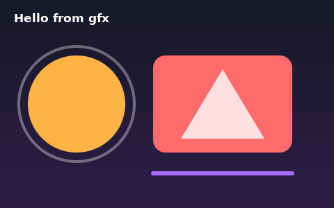
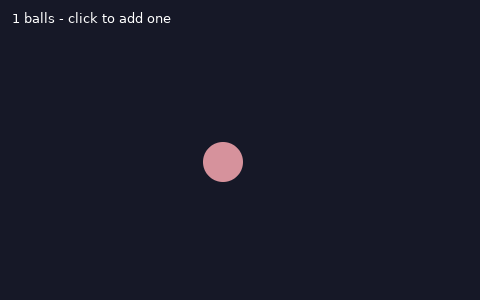
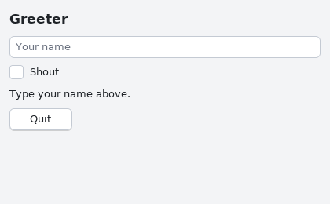
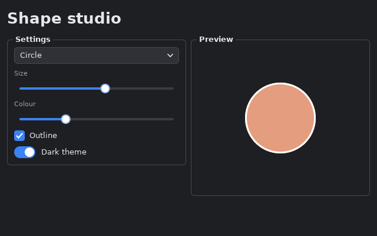

# Building a GUI

Silly comes with two modules for graphical programs:

- [`gfx`](../std/gfx.md) opens a window, handles input, and draws anti-aliased
  shapes, text and images onto canvases.
- [`ui`](../std/ui.md) builds on `gfx` with themed widgets (buttons, text
  fields, sliders, lists, tabs) in the spirit of Tk's ttk.

Both are part of the standard library, so there is nothing to install for
building. To *show* a window at run time, Silly uses SDL2 if the system has it
(`libSDL2` on Linux, which most desktops already have). It is loaded when the
first window opens, so programs build without SDL's headers.

## Drawing with gfx

A `gfx` program opens a window and runs a loop: handle the events that arrived,
draw the frame on the window's canvas, then `present` it.

```silly
import gfx

fn main():
    let win = gfx.open("Shapes", 480, 300)
    var running = true
    while running:
        for ev in win.events():
            match ev:
                case Quit: running = false
                case KeyDown(key, _, _):
                    if key == gfx.KEY_ESCAPE:
                        running = false
                case _: continue
        let c = win.canvas()
        c.gradient_v(0, 0, c.width(), c.height(), gfx.rgb(22, 24, 39), gfx.rgb(45, 30, 70))
        c.fill_circle(110.0, 150.0, 70.0, gfx.rgb(255, 179, 71))
        c.circle(110.0, 150.0, 85.0, 4.0, gfx.with_alpha(gfx.WHITE, 90))
        c.fill_round_rect(220, 80, 200, 140, 18, gfx.rgb(255, 107, 107))
        c.line(220.0, 250.0, 420.0, 250.0, 6.0, gfx.rgb(166, 107, 255))
        c.fill_triangle(320.0, 100.0, 380.0, 200.0, 260.0, 200.0, gfx.with_alpha(gfx.WHITE, 200))
        c.text(20, 16, "Hello from gfx", gfx.WHITE, gfx.FONT_HEADING)
        win.present()
        win.wait(16)
```



Colours are plain `int`s in `0xAARRGGBB` form. Build them with `gfx.rgb`,
`gfx.rgba`, `gfx.with_alpha` and `gfx.mix`, or use constants like `gfx.WHITE`.
Shapes that take `f64` coordinates are anti-aliased; `fill_rect` and the other
`int` ones snap to whole pixels. `win.wait(16)` sleeps until the next event or
16 ms, which gives about 60 frames a second without spinning the CPU.

Text is drawn with fonts that are built into `gfx`: `FONT_SANS`, `FONT_BOLD`,
`FONT_MONO`, `FONT_SMALL`, `FONT_HEADING` and `FONT_TITLE`. `gfx.text_width`
measures a string before you draw it.

## Animation and input

Events are an enum, so you take them apart with `match`. This program animates
balls and adds one wherever you click:

```silly
import gfx

struct Ball:
    x: f64
    y: f64
    dx: f64
    dy: f64

    fn step(mut self, w: f64, h: f64):
        self.x += self.dx
        self.y += self.dy
        if self.x < 20.0 or self.x > w - 20.0:
            self.dx = -self.dx
        if self.y < 20.0 or self.y > h - 20.0:
            self.dy = -self.dy

fn main():
    let win = gfx.open("Bounce", 480, 300)
    var balls = [Ball(100.0, 80.0, 3.0, 2.0)]
    var running = true
    while running:
        for ev in win.events():
            match ev:
                case Quit: running = false
                case MouseDown(x, y, _, _):
                    balls.push(Ball(x as f64, y as f64, 2.5, -3.0))
                case _: continue
        let c = win.canvas()
        c.clear(gfx.rgb(22, 24, 39))
        for i in 0..len(balls):
            balls[i].step(c.width() as f64, c.height() as f64)
            let b = balls[i]
            c.fill_circle(b.x, b.y, 20.0, gfx.mix(gfx.rgb(255, 179, 71), gfx.rgb(166, 107, 255), b.x / 480.0))
        c.text(12, 10, f"{len(balls)} balls - click to add one", gfx.WHITE, gfx.FONT_SANS)
        win.present()
        win.wait(16)
```



The full list of events is on the [gfx page](../std/gfx.md#event): `Quit`,
`Resize`, `MouseMove`, `MouseDown`, `MouseUp`, `Wheel`, `KeyDown`, `KeyUp`,
`Text` (typed characters) and a few more. Key codes are constants like
`gfx.KEY_LEFT`; a printable key is its lowercase character, so `'a' as int`.

A canvas doesn't have to belong to a window: `gfx.canvas(w, h)` makes one in
memory, `gfx.load_image` reads a PNG, and `save_png` writes one. That makes
`gfx` handy for generating images too.

## Widgets with ui

`ui` is an **immediate-mode** toolkit. You keep your program's state in ordinary
variables and describe the whole window every frame. Widgets get the state
through `&mut` and change it when the user acts; they return `true` when
something happened:

```silly
import ui

fn main():
    var app = ui.app("Greeter", 420, 260)
    var name = ""
    var loud = false
    while app.frame():
        app.heading("Greeter")
        app.entry("Your name##name", &mut name)
        app.checkbox("Shout", &mut loud)
        var msg = f"Hello, {name}!" if name != "" else "Type your name above."
        if loud:
            msg = msg.upper()
        app.label(&msg)
        if app.button("Quit"):
            app.close()
```



That's the whole program: no callbacks, no widget objects, no state kept in two
places. `app.frame()` waits for input before it returns, so an idle window uses
no CPU, and it returns `false` once the window is closed.

In `entry("Your name##name", ...)`, the text before `##` is the placeholder
shown in the empty field, and the full string identifies the widget. Two
widgets with the same label need different text after `##`.

## Layout

Widgets are placed top to bottom. A few calls open containers, and each is
closed by `end()`:

| call | lays out the widgets that follow |
|---|---|
| `row()` | left to right |
| `column()` | top to bottom, inside a row or grid |
| `grid(n)` | in `n` equal columns |
| `group(title)` | in a framed, titled column |
| `scroll(id, h)` | in a scrolling area `h` pixels tall |

`app.area(w, h)` reserves a rectangle for your own drawing, and `app.canvas()`
gives you the canvas to draw it on. This lets you mix widgets with `gfx`
drawing:

```silly
import gfx
import ui

fn main():
    var app = ui.app("Shape studio", 640, 400)
    let shapes = ["Circle", "Square", "Triangle"]
    var shape = 0
    var size = 0.6
    var hue = 0.3
    var outline = true
    var dark = true
    app.set_theme(ui.dark())
    while app.frame():
        app.title("Shape studio")
        app.grid(2)
        app.group("Settings")
        app.combobox("Shape", &shapes, &mut shape)
        app.caption("Size")
        app.slider("Size", &mut size, 0.1, 1.0)
        app.caption("Colour")
        app.slider("Colour", &mut hue, 0.0, 1.0)
        app.checkbox("Outline", &mut outline)
        if app.switch("Dark theme", &mut dark):
            app.set_theme(ui.dark() if dark else ui.light())
        app.end()
        app.group("Preview")
        let r = app.area(0, 240)
        let c = app.canvas()
        let colour = gfx.mix(gfx.rgb(255, 179, 71), gfx.rgb(166, 107, 255), hue)
        let cx = (r.x + r.w / 2) as f64
        let cy = (r.y + r.h / 2) as f64
        let s = size * 100.0
        match shape:
            case 0:
                c.fill_circle(cx, cy, s, colour)
                if outline:
                    c.circle(cx, cy, s, 3.0, gfx.WHITE)
            case 1:
                let x = (cx - s) as int
                let y = (cy - s) as int
                let w = (2.0 * s) as int
                c.fill_rect(x, y, w, w, colour)
                if outline:
                    c.rect(x, y, w, w, 3, gfx.WHITE)
            case _:
                let pts = [cx, cy - s, cx + s, cy + s * 0.8, cx - s, cy + s * 0.8]
                c.fill_poly(pts.clone(), colour)
                if outline:
                    c.polyline([cx, cy - s, cx + s, cy + s * 0.8, cx - s, cy + s * 0.8, cx, cy - s], 3.0, gfx.WHITE)
        app.end()
        app.end()
```



`ui.light()` and `ui.dark()` are the two built-in themes. A `Theme` is a struct
of colours, so you can copy one and change any field.

## The widgets

| widget | what it edits |
|---|---|
| `label`, `heading`, `title`, `caption`, `code`, `paragraph` | text (`paragraph` wraps) |
| `button`, `primary_button` | returns `true` when clicked |
| `checkbox`, `switch` | `&mut bool` |
| `radio(label, &mut cur, mine)` | `&mut int`, one of several |
| `entry`, `secret_entry` | `&mut str` |
| `slider(label, &mut v, lo, hi)` | `&mut f64` |
| `spinbox(label, &mut v, lo, hi, step)` | `&mut int` |
| `combobox`, `listbox` | `&mut int`, an index into a `&list[str]` |
| `tabs(&names, &mut cur)` | `&mut int`, the open tab |
| `progress(frac)` | shows a bar |
| `separator`, `spacer`, `image`, `tooltip` | decoration |

Every widget can be reached with Tab and used from the keyboard. The
[ui page](../std/ui.md) has the complete list, and
[`examples/ui_demo.silly`](../../examples/ui_demo.silly) shows all of them in
one window.

## Running without a display

When there is no display (on a server, in CI, or with `SILLY_GFX=headless`), a
window is **headless**: it works the same, but frames go nowhere. Two more
variables make that useful for tests and screenshots:

- `SILLY_GFX_SHOT=out.png` saves each presented frame to `out.png`.
- `SILLY_GFX_FRAMES=n` makes the window send `Quit` after `n` frames (the
  default is 3).

The screenshots on this page were made that way:

```sh
SILLY_GFX=headless SILLY_GFX_SHOT=draw.png SILLY_GFX_FRAMES=40 silly run draw.silly
```

For testing a `ui` program, `app.simulate(event)` feeds it input as if it came
from the window.
